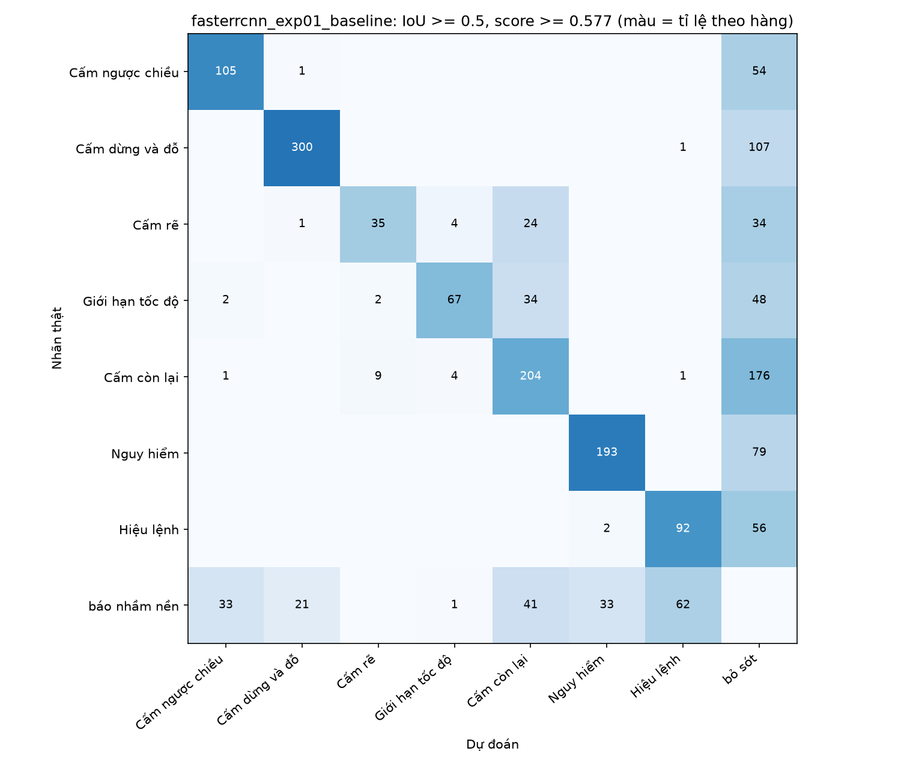

# Phân tích lỗi: fasterrcnn_exp01_baseline

- Nhãn: `data/splits/val.json`, dự đoán: `preds/predictions_val_exp01_baseline.json`
- IoU >= 0.5, ngưỡng score = 0.577 (tự chọn, F1 = 0.679)
- Tổng: 1636 biển, recall 60.9%, sai lớp 5.3%, bỏ sót 33.9%
- Báo nhầm nền: 191 box; dự đoán lặp trên cùng một biển: 23 box

## Recall theo kích thước biển (sqrt(w*h), px ảnh gốc)

| Kích thước | Số biển | Recall % | Sai lớp % | Bỏ sót % |
| --- | --- | --- | --- | --- |
| <8 | 167 | 3.6 | 0.6 | 95.8 |
| 8-16 | 543 | 41.1 | 5.5 | 53.4 |
| 16-32 | 522 | 79.9 | 5.0 | 15.1 |
| >=32 | 404 | 86.6 | 7.2 | 6.2 |

## Biển đứng cụm và đứng riêng

Biển trong cụm thường nhỏ hơn, nên so cả trong từng nhóm kích thước để không nhầm ảnh hưởng của kích thước với ảnh hưởng của cụm.

| Nhóm | Recall <8 (n) | Recall 8-16 (n) | Recall 16-32 (n) | Recall >=32 (n) | Recall chung (n) |
| --- | --- | --- | --- | --- | --- |
| Cụm | 4.3 (92) | 40.1 (282) | 83.5 (236) | 87.4 (143) | 58.3 (753) |
| Đứng riêng | 2.7 (75) | 42.1 (261) | 76.9 (286) | 86.2 (261) | 63.1 (883) |

## Theo lớp

| Lớp | Số biển | Recall % | Sai lớp % | Bỏ sót % |
| --- | --- | --- | --- | --- |
| Cấm ngược chiều | 160 | 65.6 | 0.6 | 33.8 |
| Cấm dừng và đỗ | 408 | 73.5 | 0.2 | 26.2 |
| Cấm rẽ | 98 | 35.7 | 29.6 | 34.7 |
| Giới hạn tốc độ | 153 | 43.8 | 24.8 | 31.4 |
| Cấm còn lại | 395 | 51.6 | 3.8 | 44.6 |
| Nguy hiểm | 272 | 71.0 | 0.0 | 29.0 |
| Hiệu lệnh | 150 | 61.3 | 1.3 | 37.3 |

## Cặp nhầm lẫn nhiều nhất (nhãn thật -> dự đoán)

- Giới hạn tốc độ -> Cấm còn lại: 34
- Cấm rẽ -> Cấm còn lại: 24
- Cấm còn lại -> Cấm rẽ: 9
- Cấm rẽ -> Giới hạn tốc độ: 4
- Cấm còn lại -> Giới hạn tốc độ: 4
- Giới hạn tốc độ -> Cấm ngược chiều: 2

